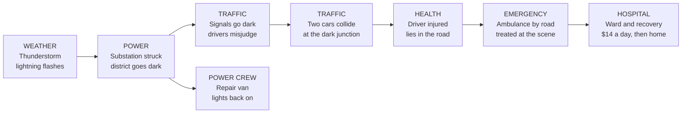

# PixelVille – Next Dimension: Game Info

Oct 26, 2026 · Suman Debnath

## At a glance

PixelVille – Next Dimension is a browser-based 3D living-village simulation: you build a town from the sky, then walk, drive, work and talk inside it while every villager lives a full simulated life. [Play it live](https://pixelvillenextdimension.houseofnamus.com/).

It is the sequel to the original 2D, top-down PixelVille. Every one of the original's systems (families, minds, elections, crime, fires, festivals, disasters) was ported behaviour-for-behaviour into a headless simulation. That simulation now drives a semi-realistic 3D world you can step into.

**The USP in one line:** the village lives without you, and everything you see on the street is real. The fire engine is the one the simulation dispatched; the queue at the bus stop is the actual queue of villagers waiting; the shopkeeper who serves you remembers you tomorrow.

|  |  |
| --- | --- |
| Genre | Life sim · city builder · open-world sandbox |
| Player role | The Founder: a god with a body, free to build from above and to roam at street level |
| Platform | Any modern browser: desktop, laptop, phone or tablet; keyboard + mouse, gamepad, touch |
| World | 256 × 256 tiles of 8 m: a 2 km square village map, plus six off-map cities |
| Time | 1 game minute per real second; a day is about 24 real minutes; a year is 28 days in four seasons |
| Villagers | Every person simulated individually: traits, memories, friends, jobs, health, schooling, opinion of you |
| Tech | TypeScript, Three.js, Vite, Vercel; AI villager chat through Groq |
| Assets | None downloaded: every building, person, vehicle, texture, tree and sound is generated in code |

### Design pillars

1. **The village lives without you.** Every system runs whether you watch or not; the 3D world is a window onto the simulation, never a replacement for it.
2. **Everything you see is real.** No fake ambient crowds or scripted traffic.
3. **You are the Founder.** Free to build, free to roam, with a light wallet for the fun of the world, and villagers who notice.
4. **Minds first.** Villagers know, remember, choose and talk. What you do enters their memories.
5. **Cozy, then dramatic.** Calm everyday life, broken by rare, visible events the village survives together.

## How to play

You found a village from the sky, then live in it at street level: build what it needs, earn money on real job shifts, and watch every villager remember what you did.

### Your first session

1. **Open the game.** A landing screen shows the logo over a slow cinematic flight across your own village (the world keeps running behind it). Choose **Continue**, **Found a new village**, **Load**, **Controls** or **Settings**. Enter continues.
2. **Pick a map mode.** Sandbox, or one of three scenarios (table below). A new village always starts on a clear morning so the first build is easy to see.
3. **Follow the first-day guide.** Nine short steps, worded for the device you are using (keyboard, gamepad or touch), each one ringing the button to press and moving on by itself when done:
   1. *Welcome, Founder:* look around.
   2. *Rise into the sky:* press P (or the crane button) to enter the Planner.
   3. *Found the village:* pick the House and click open ground beside the road. A road joins it by itself.
   4. *The first family:* speed time to 4× or 8× and watch the builders finish; the first family moves in.
   5. *Give them work:* place a Farm, Shop or Bakery. More families follow the jobs.
   6. *Come back down:* press P again to drop to the street.
   7. *Meet the neighbours:* walk up to a villager, or knock at their door, and press E to talk.
   8. *Your phone:* press Tab for the map, wallet and the Jobs app.
   9. *The village figures out the rest:* people find work, fall in love, vote, gossip and remember.
4. **Skip or replay.** "Skip the guide" works at any step; Settings → Village → "Show me around again" replays it. After a reload the guide resumes from where the village actually is.

### The core loop

1. **Build** in the Planner: homes bring families, workplaces bring jobs, civic buildings meet needs. The mayor's needs list tells you what the village is asking for.
2. **Roam** at street level: walk, drive your own car, ride the bus, train, ferry, cab or plane.
3. **Earn** on 13 playable job shifts that run on the simulation's real events, from firefighter to pilot.
4. **Spend** your wallet in the village's real businesses: food, tickets, cars, fuel, repairs, fines.
5. **Be remembered.** Every villager forms an opinion of you from what they see or hear; it sets their greetings, their prices and whether they call the police.
6. **Watch the village answer.** It grows, elects mayors, suffers storms and fires, celebrates festivals and rebuilds, with or without you.

### Map modes

| Mode | Goal | How it ends |
| --- | --- | --- |
| Sandbox | None: build freely | Never |
| The First Hundred | Grow the village to 100 residents | Won at 100; lost if the village stands empty for 7 days |
| The Rail Age | Open a railway with trains running between stations | Won when the first train runs |
| A Year Without Loss | Survive one full year (28 days) without losing a single building | Lost the moment a building is lost to fire, flood, quake or tornado |

A lost scenario never ends the game: the map carries on as a sandbox.

### Saving

- Three named save slots, plus an autosave every 2 or 5 minutes and whenever the browser tab is hidden.
- Export and import a village as a file. Saves from the original 2D PixelVille import too: the old village is placed in the centre of the bigger map with matching terrain around it, and its people, minds, ownership and mayor carry on.
- The game continues your last village when you return.

## Controls

Every input goes through one action map, so keyboard, gamepad and touch drive the same actions, and every on-screen prompt names the button for the device you last touched.

### On the street and at the wheel

| Action | Keyboard + mouse | Gamepad | Touch |
| --- | --- | --- | --- |
| Move / steer | W A S D or arrow keys | Left stick | Left thumb-stick |
| Look | Mouse (click the view first) | Right stick | Drag the right half |
| Run | Shift | L3 | Hold the run button |
| Jump / handbrake | Space | A | Jump button |
| Interact: talk, enter, buy, knock, refuel | E | X | E button |
| Get in / out of a vehicle, steal a car, departures board | F | Y | Car button |
| Accelerate / brake | W / S | RT / LT | Thumb-stick |
| First / third person | V | R3 | Eye button |
| Phone | Tab | View | Phone button |
| Planner (build mode) | P | Menu | Crane button |
| Task book and news log | J | D-pad up | Via the phone |
| Photo mode | F2 | LB | Phone → Camera |
| Plane: climb / descend | E / Q | — | ▲ / ▼ buttons |
| Help (every control) | F1 | — | Menu → Help |
| Back / cancel | Esc | B | — |
| Zoom the camera (2.5–14 m) | Mouse wheel | — | — |

### In the Planner

| Action | Keyboard + mouse | Gamepad | Touch |
| --- | --- | --- | --- |
| Glide the camera | W A S D | Left stick | Drag |
| Zoom | Mouse wheel | — | Pinch |
| Rotate the view | Q / E or right-drag | — | Two-finger twist |
| Place a building or tool | Click | A on the centre ring | Tap |
| Lay roads, rails, rivers, bulldoze | Drag | A to start, A to finish | Drag |
| Turn the door side | R | RB | — |
| Next palette tab | Click a tab | LB | Tap a tab |
| Game speed: pause, 1×, 2×, 4×, 8× | Keys 1–5 | X pauses | Speed buttons |
| Undo | Ctrl+Z | — | — |
| Inspect a building or villager | Click it | A | Tap it |

### In photo mode

W A S D fly the free camera, E / Q rise and sink, Shift goes faster, drag looks, the wheel zooms the lens, click focuses, H hides the panel, Enter saves the picture, Esc or F2 leaves.

### Control features

- **Rebind anything.** Settings → Controls lists every action; click, press the new key, Esc cancels. Taking a key from another action leaves that one unbound and says so. The plane's climb and descend are their own group, so they can share E and Q with other actions. Key names follow your keyboard layout (Z on AZERTY). "Reset to the defaults" restores everything.
- **Gamepad through every menu.** Whenever a phone, card, conversation, modal, journey screen or palette is open, the d-pad or left stick moves a highlight to the nearest control in that direction and A presses it. Nothing is hard-coded per menu: it reads what is on screen.
- **Phones and tablets.** Touch controls show from the start, the first tap goes full screen and holds landscape where the browser allows, an upright phone gets a "turn your phone sideways" card, and short screens get a compact one-row layout. The game installs to the Home Screen and opens full screen.

## The world

The village sits on a generated 2 km map whose land, water, sky, seasons and calendar all run on simulation rules, so no two villages or two years play out the same.

### The map

- **256 × 256 tiles of 8 m.** The simulation works in tiles; the renderer turns them into metres. The world is drawn in 16 × 16-tile chunks (128 m) that rebuild only where you edit.
- **Generated starter land:** forest clusters kept clear of the central build zone, lakes, a river down the east side that runs across the beach into the sea, mountain ranges of paired massifs, large forests each with its own tree species, and a sea along the south edge with a broad sandy beach.
- **Highways** enter from the west and north edges: they are the road gateways to other cities.
- **Hills and woods beyond the edge** and the sea to the horizon, so the map never ends in a void.
- **Shorelines are real slopes.** The water mask is blurred into a smooth field, so banks curve, grass or sand runs down to the waterline, and walking stops at the actual water's edge.
- **Flowing water.** Each river has its own current, computed as a flow map: downhill to the sea, quick in narrow channels, slow across lakes, still at sea.

### The big mountain

- A massif 44 tiles across and about 117 m high, with ridges, a rounded summit and forest up its lower slopes.
- A **switchback trail** climbs from a trailhead facing the village to a cairn, a flag and a bench on the summit.
- Hikers and mountain bikers use the trail by day. You can **hire a mountain bike** at the trailhead ($4 to the village fund): slow uphill, fast down, handed back at the rack.
- Every new map gets one; older villages get one placed once on their most open land; the Planner has a "Mountain peak" tool, and the bulldozer removes it whole.
- Smaller 11 × 11 rock massifs carry hiking trails and summit torches at night.

### Time and the calendar

| Unit | Length |
| --- | --- |
| Game minute | 1 real second at 1× |
| Day | About 24 real minutes |
| Season | 7 days: spring, summer, autumn, winter |
| Year | 28 days |
| Villager ageing | 1 year of age per game week |
| Elections | Every 28 days |

- The street always runs at 1×; the Planner allows pause, 1×, 2×, 4× and 8×.
- The village keeps living while the browser tab is in the background, and catches up when you return.
- An optional **Christmas lock** stops fast-forward over Christmas Eve and Day, the whole festive season, or never, so the holiday is savoured at real pace.

### Day and night

- A physically based sky with sun, moon, stars and clouds that also lights the whole scene through an environment map.
- Dawn and dusk scatter gold and rose; the camera's auto-exposure meters the sky in view, so looking into a low sun doesn't wash out to white.
- At night windows glow, shop signs and neon light up, heritage street lamps throw pools of warm light, cars run headlamps, and parked cars sit dark.
- From high over the town at night, every street lamp still paints its pool on the ground.

### Weather

- **Five states:** clear, cloudy, rain, heavy rain (thunderstorms) and snow, chosen by a seasonal state machine. Summer is 56% clear; winter is 44% snow; autumn is the stormiest.
- **An honest forecast.** The next spell is rolled in advance and shown on the HUD, and what was promised is exactly what arrives.
- Spells last 100–360 game minutes. Rain in winter turns to snow.
- **Rainbows** appear when rain stops in daylight.
- **Lightning** flashes in heavy storms and can strike a power substation.
- **Puddles** form in heavy rain (up to 220 across the map), grow while it pours, and evaporate in dry weather.
- **Surfaces react:** wet streets with mirror reflections, settling snow with tyre tracks, height fog, wind in trees and grass, leaf fall in autumn, winter ice on water.
- Bad weather adds gloom to daylight; storms darken the sky by up to 20%.

### Seasons

The world recolours each season: spring blossom, summer green, autumn leaves, winter snow cover and ice. Farms slow in winter, crops follow the seasons, and fireflies flash low over the grass at the woods' edge on warm nights.

### Calamities

Calamities are deliberately rare: none in the first two weeks, then a very low chance per minute, then a long cooldown after each one, so years can pass between them. They need at least 12 villagers.

| Calamity | When it can strike | What happens | How it ends |
| --- | --- | --- | --- |
| Drought | Summer, with enough water on the map | Rivers and lakes visibly drop day by day; farm work pays half wages; fishing boats sit idle; moods fall twice a day; without a water tower the frail can fall gravely ill | The monsoon breaks it with heavy rain and the rivers refill; early rain shortens it |
| Flood | Rainy spring or autumn | Water swells 2–4 rings out from every river and lake; buildings are partly submerged; villagers pole rafts through the streets | The rain stops and the village drains the streets together, ring by ring; up to three stretches of road wash out for good |
| Earthquake | Any season | The camera shakes; 2–4 buildings crack or collapse with casualties; a ruptured gas line can set a cracked building ablaze; safety drops | An aftershock, then rubble cleared and cracks patched |
| Tornado | Any season but winter | A funnel crosses the whole map from one edge, shredding trees, tearing buildings apart or damaging them, cutting power in every district it crosses; sirens wail | The funnel lifts at the far edge and rebuilding starts the same day |

Every calamity is announced, opens a task in the task book, and closes with the village's own line of pride when it is survived. Ruins are later rebuilt by the community.

### The festival calendar

Feasts fall on the same days every year, so traditions really are traditions.

| Day of the year | Festival |
| --- | --- |
| 1 | New Year's Day: confetti, resolutions, fireworks past midnight |
| 4–5 | Easter: painted eggs on doorsteps, egg hunts and picnics in the parks |
| 15–16 | Christmas tree scouting: the head gardener searches by helicopter; a family offers the giant spruce in their garden |
| 17 | The cut: a crane holds the tree while the crew saws; it is laid on a flatbed |
| 18 | The haul: at 10:00 the flatbed crawls through town between two squad cars on blue lights, traffic waiting behind |
| 18–19 | Diwali: diyas on every sill and two nights of town-wide fireworks |
| 19–21 | Raising: a crane stands the tree in the square, scaffolding goes up, lights go on from the bottom up; on day 21 the crane hoists the star |
| 22 | The lighting ceremony: a stage, performers and a crowd from 20:00, PVTV live; the tree lights at 21:50 |
| 22–28 | The Christmas season: every building decorated, 1–3 Christmas markets (more as the village grows) with stalls, carolers going door to door, Santa strolling the pavements by day, his sleigh crossing the sky at midnight dropping twinkling gifts, a skating rink with skaters |
| 24–25 | Christmas Eve and Day: the tree lit all night |
| 27–28 | New Year fireworks: two nights, from every rooftop |
| 2 (next year) | The tree comes down; its timber goes to a home under construction |

The tree is a 24 m spruce with 1,400 lights, a star and garlands. It is lit 05:00–midnight through the season and until 21:00 on New Year's Eve. A village loaded mid-season picks the tradition up exactly where it would be. Market ground is reserved so the road planner never runs a street through a festival.

### Wildlife and ambient life

Hikers on the trails, birds, ducks on the water, butterflies, fireflies, beachgoers, tourists, and sky events, all part of the simulation rather than decoration.

## The villagers

Every villager is an individual with a personality, a diary of memories, friends, a job, a household budget, health, schooling and an opinion of you, and every choice they make is scored from those, not rolled at random.

### Personality

Each villager is born with five traits, fixed from their own seed:

| Trait | What it changes |
| --- | --- |
| Social | Makes friends fast, invites friends along for the evening, prefers busy venues |
| Caution | Remembers danger longer, avoids places that hurt them, takes a bad deed by the Founder harder |
| Ambition | Hunts promotions and better-paid jobs, enrols in college |
| Thrift | Weighs every price tag, travels less far to save money |
| Curiosity | Tries new places without being told about them |

### The mind: knowledge, memory, friendship

- **Knowledge is earned.** A villager only knows the places they have been, heard about from a friend in the street, or seen on PVTV. They grow up knowing their own neighbourhood. A new shop spreads by word of mouth, or instantly to every home if the village has a TV station.
- **An episodic diary.** Up to 14 memories each (fires, jackpots, weddings, failures, promotions, the Founder's deeds), each with a feeling from −2 to +2. Memories fade after 20 days; only the strongest stay for good.
- **Scars change behaviour.** A fresh bad memory tied to a place keeps a villager away from it for 6–16 days, depending on caution.
- **Friendships** grow from street meetings and shared evenings, and cool a little each night without contact. Firm friends are announced.
- **Favourite places.** Enjoying a venue builds affinity; a regular calls it "my usual spot".
- **Gossip.** When two villagers meet in the street their bond deepens, they pass on a place the other hasn't heard of, strong recent stories colour the listener's mood, and stories about the Founder travel on.

### Decisions, not dice

When a villager chooses where to shop or spend an evening, every open venue is scored on distance (weighted by thrift), favourites (+7 per affinity point), the thrill of somewhere new (curiosity), menu prices (thrift), how busy it is (social), and fear of past bad experiences. A freshly opened venue draws half the town on its grand opening day. A household short of money picks free fun: parks, playgrounds, the library, the temple.

### A day in a villager's life

Every morning each villager plans the day as a list of timed events, shaped by age, job, weather, season and mood:

- **Children** under 5 stay home. Schoolchildren go to school on weekdays and often play at the park or playground after; weekends bring the pool, the zoo or the amusement park.
- **Working adults** commute to their job's opening hours, may take lunch at a nearby café, restaurant or bakery, run errands after work, stop for tea at the corner stall, and go out in the evening.
- **Students** take two weekdays in five off work to study at the college; the jobless attend college most weekdays.
- **Retirees** take slow mornings at park benches, the library or the temple, shop in the afternoon and stroll.
- **Evenings out** are 45% likely on weekdays and 75% at weekends, halved in rain or snow, up in summer, down in winter, and more likely when someone is gloomy and looking for cheer. Sociable villagers call a friend to come along.
- **Walks** around the block, often with the dog.
- In the Christmas season the markets pull everyone in for lights and shopping.

Trips longer than about 10 tiles use the family car or motorcycle, a taxi or the bus.

### Mood

Mood follows real circumstances each day: having work, household savings, the town's safety, a damaged or burning home, trouble with the law, owning a business, yesterday's outing, clear weather, fresh memories, and friendship. Two or more firm friends lift it; a lonely adult with no partner and no friends feels it. Mood in turn drives votes, protests and how people spend their evenings. Thought bubbles over heads show where someone is heading or how they feel.

### Lifestyles

Every adult has a lifestyle that sets how much they save and what they dream of:

| Lifestyle | Share | Saves | Dream |
| --- | --- | --- | --- |
| Worker | 40% | 22% | A career |
| Shopkeeper | 15% | 46% | A small shop, bakery, café, florist, barber, tea stall and more |
| Entrepreneur | 14% | 50% | A pharmacy, garage, gym, jeweller, gas station, showroom and more |
| Neighbour | 8% | 26% | Community |
| Tycoon | 6% | 55% | A hotel, cinema, mall, casino, fast-food franchise or skyscraper, funded by a loan |
| Farmer | 6% | 42% | A farm |
| Risk-taker | 6% | 38% | A quick business, funded by risk |
| Industrialist | 5% | 52% | A sawmill, steelworks, factory, power plant or dock, funded by a loan |

### The circle of life

- Children grow up and turn 18, certificate in hand, looking for work (and maybe dreaming of a business).
- Sweethearts are seen together at the park, fall in love, move in together and marry at a church or temple.
- Couples announce a baby on the way, then welcome the newborn.
- Some couples separate: one moves across town or leaves for a fresh start.
- Newlyweds move into a place of their own, or build their first house together.
- Workers retire at 65; from 70 the frail are at risk, and old age is informed by health. Elders pass away peacefully, at home or in hospital, and the village mourns.
- A villager ages one year each game week, so you see whole lives unfold over a few weeks of play.

### Household economy

- **Wages** by workplace ($8 a day at a tea stall to $28 at a skyscraper), raises, promotions to senior staff and management posts.
- **Savings** go to house upgrades: an extra floor at $250 saved, a villa at $600, even a mansion that brings the street out to stare.
- **Purchases:** a car, a motorcycle from the showroom, a fishing boat that brings in extra income from the catch.
- **Landlords:** well-off families build rental homes.
- **Bills:** power and water once a day.
- **Luck:** a rare lottery win of $400.
- **22 side gigs** for anyone between careers, tied to seasons and terrain: babysitting, dog walking, tutoring, fishing at the lake, busking, shovelling snow in winter, picking berries in summer, a summer lemonade stand, foraging mushrooms in autumn, helping with the harvest, guiding tourists where there's a hotel, and more.
- **Bank loans** with daily repayments: paid off, written off on default, or a foreclosure that shutters the business.
- **The casino**, where the house usually wins: a jackpot now and then, and sometimes a family's savings gambled away.
- **A stock market** of five hometown tickers that move with the real village: AGRI (Valley Farms Co.), INDL (PixelWorks Industries), RETL (Main Street Retail), RAIL (Village Rail & Transit), BYTE (ByteVille Tech). Rallies and shocks make the news; villagers cash out.
- **Hard times:** a broke household can't pay its bills, and after a while packs up and leaves.

### Ambitions and business

- Villagers with a business dream save toward a startup cost ($90 for a tea stall to $1,700 for a skyscraper), buy a plot, and open their own business, which the village then builds.
- Ambitious workers leave for a clearly better-paid job, but only one they have heard of.
- Businesses live on footfall: one with barely a customer all week struggles, then may go out of business; a busy one is announced as booming.
- **Pioneers** leave the crowded streets to homestead in the far countryside, often starting a farm, tea stall, shop or gas station beside it, so the outskirts come alive.
- A rare petty theft by a desperate villager puts their business plans on hold.

### Wellbeing and community

A villager who stays low for days withdraws, and the neighbours notice. Family, friends, counsellors or neighbours rally round, and most find light again or a new purpose; some leave to start over. The original's mature storylines are kept and told through news and memories, never shown graphically.

### Health

- Every villager has health from 0 to 100, lower in old age.
- **Illness:** colds, flu, stomach bugs and pneumonia, more in autumn and winter, more for the old, the young and the poor, passed round the household. A flu wave arrives once a winter with a PVTV bulletin.
- **Injuries** come from what already happens: car crashes (worse at a dark junction), fires (people carried out with smoke in their lungs), collapses, earthquakes, tornadoes, street fights, and vehicles hitting people on foot (scaled by speed and vehicle size, from a motorbike to a bus). Nobody dies of an injury.
- **Ambulances:** a serious case lies down where it happened; the nearest hospital sends an ambulance by road, two paramedics treat them at the scene, then drive them to the ward on blue lights. With no hospital or no road, neighbours help them home.
- **The ward:** 12 beds when fully staffed; a full ward treats people in casualty and sends them home. Recovery is fastest on the ward, slower at home, slowest in a town with no hospital, where the family frets. Patients pay $14 a day (the village fund covers what they can't). The sick stay off work and school; a pharmacy takes the edge off a cold.

### Education

- Three levels: none, a school leaving certificate (10+ days of school, awarded at 18), or a college degree (12 days at a fully staffed college).
- **Graduate posts** pay 45% more and only graduates can fill them: doctors (half the hospital), lecturers (70% of the college), teachers (half the school), engineers (40% of the power plant), and posts at the bank, stock exchange, airport (pilots), TV station, courthouse, offices, skyscraper, town hall and pharmacy.
- A post nobody in town can fill draws a skilled family in from outside, at most one a day (by air if there's an airport).
- Short-staffed graduate posts matter: fewer doctors heal slower, fewer engineers make less power.
- Essential services (hospital, power plant, fire and police stations, water tower, school) hire first when hands are short, taking two people a day from ordinary jobs.

### What they think of you: reputation

- Each villager holds an opinion of the Founder from −10 ("can't stand you") to +10 ("adores you"), moved by what they see or suffer:

| Deed | Change |
| --- | --- |
| Bringing a lost dog home | +4 |
| Joining the bucket line at a fire | +3 |
| Helping at a crash | +1 |
| Being a paying customer (staff only, up to "likes you") | Small rises |
| Your careless driving seen | −0.5 |
| Seeing an arrest | −1 |
| Seeing a crash, a theft or an attack on the police | −2 |
| Seeing a hit-and-run | −3 |
| Their car stolen or wrecked by you | −4 |
| Knocked down by your car | −6 |

- **Stories travel.** Each deed carries a gist ("…that the Founder knocked Tomas down with their car"). Neighbours chatting in the street and families at dinner pass the freshest story on, up to three hops and a week old. Friends sway each other more. A bad story never makes anyone like you more. With a TV station, PVTV carries the big ones to every home.
- **Views cool** about 3% a night.
- **On the street:** fans wave and say good morning; those who dislike you scowl and hurry past. Witnesses who can't stand you report even your driving; loyal fans look the other way for anything short of a hit-and-run. While you're wanted, anyone who dislikes you and spots you phones the police.
- **At the counter:** 10% off from staff who like you, 20% from fans, and refusal from staff who can't stand you.
- **Doors:** a household only asks you in if they like you; otherwise you knock and the eldest comes to the door.
- The HUD shows the village's view in a word: A newcomer, Well liked, Beloved, Mixed feelings, Disliked or Notorious.

### Talking to villagers

- Press E beside anyone: in the street they stop to talk; indoors they turn to face you.
- **AI conversation.** Type anything. The villager answers in character through a language model, grounded in a compact context: their age, family, job, home, two strongest traits, mood, recent memories, everything they remember about you and their opinion, friends, favourite place, the last nine days of real village news, the weather, the hour and where you are.
- **In-world rules** live on the server: stay in the village, never mention AI or games, the Founder is a mysterious local figure, short replies in their own manner, only what they would know, no graphic content.
- **Validated effects.** The model can propose small changes (opinion of you, mood, a memory, a place they've heard of), and the game clamps them: at most ±1 opinion a turn and −2 to +1.5 a conversation, so chat can never break the simulation.
- **Template fallback.** Without AI, or when limits are hit, villagers speak from mind-driven templates: greetings by opinion and time of day, and topics from their own life (how they are, their work in their trade's voice, family, news, events to ask about such as the bakery fire or the power cut, what people say about you, where's good to go). Someone who can't stand you won't chat.
- **They remember.** One memory per conversation, plus a record of meeting you that their next greeting brings up ("You were asking me about the fire at the bank yesterday — I've been thinking about it since").
- **Contacts.** Everyone you've talked to appears on your phone: call them (nobody picks up between 23:00 and 06:30) or find where they are now.
- Subtitles show street greetings with the speaker's name.

## Town systems

The town runs on interlocking systems (building, government, money, goods, power, traffic, transit, crime and emergencies) where each one's output is another's input, so a storm, a shortage or an election ripples through the whole village.

### Building the village (the Planner)

- **87 placeable building types** in six categories, plus two house upgrade levels and terrain tools:

| Category | Examples |
| --- | --- |
| Residential | House, Cottage, Apartments, Row Houses, Mansion |
| Work and industry | Office, Skyscraper, Factory, Farm, Steelworks, Sawmill, Brickworks, Textile Mill, Cannery, Glassworks, Warehouse, Power Plant, Stock Exchange, Airport |
| Shops and services | Shop, Supermarket, Mall, Department Store, Restaurant, Café, Bakery, Hotel, Bank, Gas Station, 16 speciality shops, Auto Garage, Car and Motorcycle Showrooms, Tea Stall, Fish Market, five fast-food chains |
| Civic | School, College, Hospital, Police, Fire Station, Town Hall, Church, Temple, Library, Courthouse, Post Office, Water Tower, TV Station (PVTV) |
| Leisure | Park, Playground, Amusement Park, Stadium, Cinema, Theater, Museum, Gym, Swimming Pool, Grand Park, Town Plaza, Zoo, Casino, Boat Club |
| Transport | Bus Stop, Taxi Stand, Train Station, Dock, Heliport, Railway |
| Terrain and tools | Forest, Pond, Lake, River, Mountain, Mountain peak, Road, Bulldoze |

- Each type carries real data: footprint, jobs, opening hours, Sunday opening, what kind of visit it serves, residents, power demand, goods, the education its jobs need, and which interior and playable job it has.
- **Facing.** Buildings face north, east, south or west; R turns the door; by default the door faces the nearest road.
- **Auto-road.** Place a building and a road joins it by itself: an A\* search over terrain costs with a turn penalty lays a two-lane avenue to the nearest network. Drag roads, rails and rivers by hand too.
- **Ghost preview** and road-access warnings while placing; Ctrl+Z undoes.
- **Visible lifecycle:** a site with scaffold and crane, construction crews working at the height the walls have reached, a labourer carrying loads from pallets, a foreman with plans; then the finished building; upgrades that add real floors; renovation scaffolds; fire and smoke; ruins and rubble; snow on roofs; festival lights.
- **One shared builder crew.** The village has 3 builders plus one per 8 adults, so many simultaneous projects all slow down. Small homes go up in a morning; a stadium is a season-long project.
- **The village builds itself too.** Families move into empty homes when there is work, entrepreneurs open businesses, pioneers homestead, the mayor builds civic works, and neighbours pool money when the mayor doesn't.
- **City planning.** The village's own builds are placed by a planner that scores spots: homes near work, shops and civic buildings walkable from homes, docks hugging the shore, growth outward from the road network.
- **Village tiers,** each celebrated with a charter when first reached: Hamlet, Village (21 residents), Town (61), City (121), Metropolis (201).
- **Land prices** follow the market: central plots near the town hall cost up to seven times a field at the map's edge, waterfront +30%. Places are named by band: town centre, inner district, outskirts, far countryside.
- **Growth pace** is a setting; Cozy damps growth as the town fills out.
- **R/C/I demand** on the minimap shows the pull for residential, commercial and industrial building.

### Government and elections

- **The first election** comes once six adults live in the village; then every 28 days, after a 7-day campaign.
- **Four kinds of mayor,** each with its own build list and appetite:

| Mayor | Builds | How often they act | Skims taxes |
| --- | --- | --- | --- |
| Visionary ("a pure heart") | Parks, schools, libraries, hospital, pool, zoo, museum, theatre, college | Most often | 0% |
| Business mind | Shops, offices, factory, mall, bank, train station, dock, exchange, power plant, skyscraper, airport | Often | 8% |
| Steady planner | Fire and police stations, school, park, library, bus stops, post office, water tower, TV station | Less often | 3% |
| Smooth talker (corrupt) | A town hall office for themselves | Rarely, and ignores most needs | 55% |

- **A visible campaign:** banners on the verges, campaign cars, rallies with promises built from the village's real top need ("a new hospital and a better life for every family"; the corrupt candidate promises "gold-paved roads, somehow"), and voting booths.
- **Every adult votes on their own quality of life:** a job, savings, safety, shops, leisure, a school for their kids, a hospital in a bigger town, fires or crime with no service, a ruined home, their own lights out, recent blackouts, the sick with no hospital, empty shelves, and their mood.
- **Approval** follows quality of life and recent builds, minus scandals and grievances. Auditors report missing funds under a corrupt mayor.
- **Taxes:** you set low, normal or high in the mayor's report. Light taxes please people and starve the treasury; heavy ones fund the mayor's plans and sour the streets. Businesses pay a cut at normal and high.
- **The needs list** drives the mayor's spending. It responds to real problems: rolling blackouts put a power plant first, the sick with no ward bring a hospital forward, a full ward asks for a second, unfilled graduate posts ask for a college, a flu wave for a pharmacy, shortages for the matching producer.
- **Service coverage:** a police station reaches 32 tiles, a fire station 30, a school 36. When the town outgrows them, the mayor aims a second station at the densest uncovered cluster. Surplus services are decommissioned in a budget review.
- **Programmes:** a bus network rolled out wherever riders are far from a stop; a railway programme the treasury saves for once the town passes 45 people; road crews relaying streets to cut-off buildings.
- **Community self-building:** tired of waiting, villagers pool their savings to build what the mayor ignores.
- **Resignations and snap elections** when a mayor leaves the village or loses all trust.
- **Riots** happen only for concrete reasons (the grievance report: poor living conditions, too few jobs, unsafe streets, fires without a brigade, crime without police, blackouts, no hospital, empty shelves, missing public money, lost trust), never as random flavour.
- You can never run for mayor: elections stay the villagers' own. You influence them through what you build and do.

### The money rule

Money is never conjured or destroyed. What you spend in a business is its income; a household's thank-you comes from its savings; public-service wages come from the village fund. When the fund is empty it owes you and pays as taxes arrive. Wages per workplace, prices per visit, household funds, business tills and the treasury are one closed economy.

### Supply chain

| Good | Made by | Sold or used by |
| --- | --- | --- |
| Food | Farm, cannery, fish market, bakery | Supermarket, market, restaurants, cafés, food shops |
| Materials | Sawmill, brickworks, steelworks, glassworks | Building sites, hardware and furniture stores |
| Textiles | Textile mill | Tailor, department store, mall |
| Products | Factory | Shops, electronics, toy shop, department store |

- Producers fill their yards (up to 90) while staff are on shift; farms slow in winter and drought; nothing runs in a blackout.
- **Shelves:** each shop holds its own good (a supermarket 60 food, a tailor 24 textiles). Thin shelves cost up to 40% more; bare ones sell nothing and the customer goes home disappointed.
- **Delivery trucks,** painted by what they carry, haul loads of up to 20 through the real traffic from yards, the warehouse or the station's goods shed to shops and sites; the driver wheels the load in.
- **Surpluses** go to the warehouse, ship by rail, or export by road for income.
- **Imports** come by truck from the map edge, dearer, within a daily allowance that grows with the village (more with a freight railway). The freight train stocks the goods shed with whatever is short.
- **Building eats materials:** a site needs 8 + 2.5 per tile; builders bring part of it; a site that runs dry stands idle with an empty yard and the crew waiting until a load arrives. Pallets of bricks and timber appear as loads come in.
- Shortages begin and end in the news and move the stock tickers.

### Power and blackouts

- Every building draws power (a home 1 per floor, an apartment block 4, a skyscraper 14, a steelworks 12), less at night and more in the evening peak.
- A staffed power plant gives up to 160; the county line along the highway brings 60 and is billed to the village fund.
- The grid is split into 32 × 32-tile districts. When demand exceeds supply, **rolling blackouts** move district to district every 90 minutes, and the hospital's district goes last.
- **Faults:** lightning strikes a substation, heavy rain brings trees onto lines, ice comes with heavy snow; the tornado cuts every district it crosses, the earthquake one or two, a flood the one under water; at most three at a time.
- **Repair crews** drive out from the power plant through traffic and work 40–75 minutes; without a plant the county sends one an hour later.
- **In the dark:** windows, signs, neon and street lamps go out across the district; the hospital runs on its generator; traffic lights go dark and drivers treat the junction as unsignalled and misjudge each other there; shops and venues shut; works stop producing; families sit by candlelight.

### Traffic

- **Every vehicle looks ahead** along its own path: it keeps its distance in queues, stops for people on the carriageway, brakes for red lights and lowered crossing gates at the stop line, and takes turns at unsignalled junctions, first come, first through.
- **Speeds follow stopping distance,** so traffic pulls away and closes up smoothly at any game speed.
- **Jams resolve themselves:** stuck behind crossing traffic, a driver edges out after 6 s; stuck behind something parked, it squeezes past after 10 s.
- **Overtaking:** a driver behind a stopped vehicle pulls into the oncoming lane only when the road runs straight with no junction, lights or crossing ahead and nothing coming.
- **Real lanes and bends:** vehicles keep right, follow quarter-circle arcs through corners (tight rights, wide lefts), slow for bends, and swing round dead ends.
- **Keeping right on avenues:** route planning penalises turns and the oncoming carriageway, so routes are straight and legal; buses run one-way loops; service vehicles plan their own way back.
- **Parking:** cars wait in their drive for a gap, pull out on a curve, and reverse into their spot at the end of the trip. Venues and workplaces have bays across the front of the plot; cabs queue along the kerb at the rank.
- **Traffic lights** at the busy junctions the sim chooses, on 8-second phases; level-crossing gates for trains; bridges where roads cross water.
- **Road rules for villagers too:** a villager who stays in the oncoming lane or drives an avenue's wrong row is fined from the household's funds.
- **They see you:** drivers queue behind your car, stop for you on foot, and honk after two seconds held up. Emergency vehicles keep right of way and slow for people in the road.
- **Hits:** a vehicle that runs into someone on foot hurts them by speed and size; a driver can't stop dead for someone stepping out inside the stopping distance.

### Pedestrians

Walkers keep to the pavement on their door's side, cross side-street mouths on the crossing line, round corners on the kerb, wait at the kerb for a gap before crossing, each at their own pace and line, stepping aside to pass. People waiting to cross stand a step apart.

### Public transport

- **Buses:** the village line chains stops into a loop; up to 3 buses; real queues at stops, longer at rush hour. Service 05:30–21:00, an evening bus, last bus 23:30.
- **Trains:** player-laid rails carry local, commuter, express and freight services, each on its own track with a timetable; passenger trains run 05:30–23:30 (the original's night sleeper is retired) and freight runs through the night.
- **The national railway:** a station brings a branch line to the nearest map edge, and the Intercity Express calls every three hours 07:00–22:00, standing 14 minutes at the platform.
- **Taxis** work the streets from the ranks; the ferry sails 06:00–22:00; flights every three hours; helicopters from the heliport.

### Crime and justice

- Burglaries at night (more with unemployment), street disputes and crashes by day, and rare petty thefts.
- Police come from real stations by road. No station, nobody comes; the culprit slips away.
- Grave crimes are rare: an arrest, a trial at the courthouse two days later and a verdict (no courthouse, no proper trial). Told through news and aftermath, never shown graphically.
- Town safety (0–100) falls with crime, heals over time and with arrests, and feeds votes and moods.

### Fire

- Buildings ignite at random: factories three times as often, restaurants and bakeries twice; a fire inspection this week cuts the risk to 35%.
- A fire burns for 5–7 game hours and spreads to neighbours unless a hose is on them. Some people inside are carried out with smoke in their lungs.
- The fire brigade is dispatched from the nearest fire station by road. Without one, neighbours form a bucket brigade.
- A building lost becomes a ruin; then the community rebuilds it.
- Buildings can also suddenly collapse; neighbours rush to help and a community rebuild follows.

### PVTV and the news

PVTV is the village's own channel: breaking headlines from real events (a fire, a wedding, an election, a shortage), a stock ticker, and reporters who turn up at incidents. A TV station makes every new place and every big story about you reach every home. The task book (J) tracks the village's open tasks (survive the drought, build the hospital) and keeps a news log.

## The Founder

You play the Founder: a god with a body who builds for free from the sky but lives on the street with a light wallet, a garage, a reputation and a police record, like anyone else in town.

### Who you are

- A violet coat, gold scarf, wide-brimmed hat and a faint golden ring at your feet. No hunger, sleep or ageing.
- Walk, run, jump, drive, ride and work. Third-person camera with wall collision (it never clips into buildings, awnings or balconies) or first person with a gentle head bob.
- **Health on foot:** a vehicle can knock you down; the screen's edges go red and you mend in 6 seconds; enough of it is "Wasted".
- **The Founder's Lodge** is your home, spawn point and garage; its drive is always legal parking. The Lodge's garage keys hang on a hook inside.
- **The Planner is locked** while you are wanted or on a shift: god powers are not an escape hatch.
- Villagers know you as the mysterious Founder, the stranger around whom buildings seem to appear. They never break the fourth wall.

### Wallet and bag

- Starts at $120, with a ledger of the last 80 entries; the wallet pill flashes green or red with each change.
- **Earn** from job shifts, a lost dog brought home, helping at a fire or crash, scratch-card prizes.
- **Spend** on food and drink, shop wares, tickets, taxis, vehicles, fuel, repairs, fines and hospital bills.
- **The bag** holds up to 16 items (food, tickets, souvenirs); food and drink can be eaten from it.
- **Debt:** what you can't pay is owed to the village fund and taken as money comes in.

### Vehicles and motoring

| Vehicle | Where | Price |
| --- | --- | --- |
| Pixel Hatch, Ville Saloon, Meadow Estate, Ridge 4×4 | Car Showroom | $280–520 |
| Sprite 125, Ridge 650 motorcycles | Motorcycle Showroom | $160–260 |
| Mountain bike (hire) | The trailhead | $4 |

- You start with your own saloon. Every vehicle comes in ten paints and keeps its fuel, dents and whereabouts in the save; one is out at a time, the rest wait in the Lodge garage.
- **Part exchange** at 55% of the price less wear, paid from the showroom's own till.
- **Arcade handling per vehicle:** top speed, acceleration, range, tank, turn rate. Motorcycles are quicker off the mark and lean into turns.
- **Fuel** drains with distance (about 26 km a tank for a car, 20 for a motorcycle); a warning at 15% pins the nearest pumps; an empty tank only crawls. Stop on a gas station forecourt and press E.
- **Damage** from knocks and crashes costs top speed past 50% and leaves a wreck at 100%. The auto garage (08:00–18:00) repairs it; a wreck can be towed there.
- **Parking:** where there's a police station there are wardens. Leave a car in a junction, at lights or a crossing, in a bus stop or rank, on the railway or in the carriageway: a $15 ticket after 45 minutes, a tow to the impound after two more hours, $40 to collect.
- **The Garage app** lists every vehicle with fuel, condition and location, finds it by GPS, and calls a $35 tow.
- Chase and cockpit cameras, a speedometer and fuel gauge; headlamps with rounded lenses and projector bulbs, daytime running lights.

### Crime and the wanted level

- **Stealing a car:** F beside a family's car in its drive. Your own car stays where you left it. A stolen car left behind goes home to its family; a save never keeps one.
- **Who saw it decides.** Road offences count only if a squad car or a road camera sees them. Crashes, people knocked down, car theft and ramming the police also count if a villager within 32 m sees them, and those villagers remember it. Buildings block a crew's view. An unwitnessed theft is reported 20–45 minutes later and the car becomes "hot".
- **Tickets:** red lights, speeding over 60 km/h and the wrong side are fined; three in five minutes under a patrol's eyes start a chase. On blue lights during a shift, road rules don't apply.

| Stars | Trigger | Response |
| --- | --- | --- |
| ★ | Road offences, crashes | 1 squad car from the nearest station |
| ★★ | Hit-and-run, car theft | 2 squad cars |
| ★★★ | Ramming the police | 4 cars from every station, roadblocks across the road ahead |
| ★★★★ | A fresh crime mid-chase | 6 cars, spike strips that shred tyres |
| ★★★★★ | Sustained rampage | 8 cars and the police helicopter, if the village has a heliport (sees 160 m) |

- Units drive from real police stations through the road network and re-route to where you were last seen. No police station, nobody comes; coverage gaps are real escape routes.
- **Escape** by breaking line of sight: out of sight for 16/24/34/46/60 seconds, a star drops. Stars flash while a crew sees you, with a gauge filling toward the next drop. Villagers who dislike you phone in your position and reset it.
- **Busted:** a crew alongside for two seconds. A fine of $40–360 by stars, your own car impounded, and a night in the cells till 07:00 (or five hours by day) behind a curtain. You walk out of the station.
- **Wasted:** a crash at about 80 km/h. Patched up at the hospital (a bill up to $120), four hours pass, the car is towed, the chase is forgotten.
- Villagers are never killed by you: violence and crashes injure, and the injured go to hospital.

### The 13 job shifts

Shifts run on the simulation's real events. Start from the phone's Jobs app (it routes you there and the shift starts at the door) or from a workplace's card or counter. The workplace lends its vehicle at the kerb, and fires, break-ins, crashes, casualties and power cuts come to you first; take too long (40–90 game minutes) and the village's own crew goes instead.

| Job | Workplace | The loop | Effect on the village |
| --- | --- | --- | --- |
| Firefighter | Fire station | Drive the engine on blue lights; face the flames and the hose does the rest; fire inspections between calls | Buildings saved; inspected businesses' fire risk cut for a week |
| Police officer | Police station | Catch the burglar (E beside them), calm street quarrels, secure crashes; walk the beat | Arrests; patrolled areas deter crime |
| Paramedic | Hospital | Treat casualties on foot, drive them in, hand over to the ward; home visits to the sick | Faster recovery |
| Taxi driver | Taxi stand | Real villagers leaving work or venues hail you; pull up, drive them, drop at the door | Fares and tips into the rank's till |
| Bus driver | Bus stop network | Drive the loop; the real queues board at each stop | Timetable bonus; commuters carried |
| Delivery driver | Warehouse, factories, works | Load at a yard with stock, unload at a shop running low or a site waiting for materials | Shelves restocked, sites unblocked |
| Train driver | Train station | W power, S brake; stop with the cab at each platform; overruns and buffers count against you | Riders carried; timetable bonus |
| Pilot | Airport | Throttle up, lift the nose, fly off the map's edge; turnaround in the city; line up, cross the fence low, the plane flares; taxi to the stand | Visitors and import allowance |
| Electrician | Power plant | Power cuts come to you; a three-stage repair at the pole; service substations between faults | Lights back on; 65% less storm damage for a week |
| Construction worker | Any building site | Carry loads from pallet to scaffold (each lays 18 minutes of work); fetch materials by van when the pallet is bare | Faster construction |
| Shop worker / chef | Any shop or café with wares | Take each real customer's order, make it at the counter, serve it | Till takings and tips; customers grow fond of the place |
| PVTV reporter | TV station | The editor assigns real stories (fires, crashes, rallies, power cuts, stalled sites, bare shelves, booming businesses); film with the subject in shot; file at the station | Your story airs on PVTV; shortage stories raise the import allowance |
| Farmer | Farm | Drive the tractor along each crop row: harvest in summer and autumn, sow in spring, plough in winter | Food to the yard; +30% yield for a week |

- **Stars 1–5** rise with good work and drop 0.6 with each failure.
- **Pay** = (hourly rate × hours + task pay) × (0.7 + 0.1 × stars), paid at clock-off by the village fund (public services) or the workplace's till. A good 8-hour shift pays about $40–150, so a car is two to five good shifts.
- Shifts last up to 8 hours (14 for the pilot) with a little overtime to finish.
- **Career record:** shifts by job, hours, earnings, best stars, and wages still owed.
- A shift card shows the job, objective, progress, time left, pay so far and stars, with a floating marker over the next target.
- Shifts never replace a villager's job: you work alongside the staff or cover an empty post.

### Getting around: transit

- **Departures board:** F at a stop, station, dock, rank, airport or heliport shows what leaves next and the fare.
- **Bus, train, ferry:** wait at the kerb until the village's own vehicle pulls in; pay the fare or punch a ticket; the camera rides along; get off at any stop, or automatically at your chosen or GPS stop.
- **Cabs:** call from the phone or take one at a rank; a real cab drives to you through traffic; the meter is $3 plus a little per tile.
- **Tickets** from machines: singles, day returns, week rovers, ferry tickets, an island day trip, flights, the air taxi and the sightseeing flight.
- **The sightseeing flight** ($60): up to 75 m in a wide circle round the village.
- **GPS:** road-following routes that re-plan when you stray, amber chevrons on the road ahead, the route on the minimap, a pill with the distance. "Go there" and pinned toasts set routes.

### Travel beyond the map

| City | How to get there |
| --- | --- |
| Westmere | West highway or intercity |
| Northbridge | North highway or intercity |
| Avalon City (the capital) | Intercity, flight or air taxi |
| Harbourton (the port) | Intercity or by sea |
| Saltmarsh Isle | By sea |
| Solano (a sunny resort) | Flight |

1. **Leave from a gateway, seen in the world:** ride the intercity to the map edge, watch your plane take off, sail from the dock, lift off in the air taxi, or drive off the end of a highway.
2. **The journey screen:** a line from here to there with your vehicle moving, while the village's real simulation races through the hours; something happens on the way (a job lead, the papers, a delay, a view, a chat).
3. **The city:** look around for two hours (a sight, sometimes an odd job), buy its souvenir, stay the night ($30), or head home. Broke? Work a day for the fare.
4. **Coming home:** the train pulls in, the plane lands, the steamer docks.
5. **While you were away:** how long you were gone, villagers gained or lost, what was finished, what is going up, and the news you missed.

**Flights** to Avalon City and Solano leave every three hours; check in at the terminal (closing 20 minutes before), wait at the gate, board.

**Through the gateways come others too:** visitors arrive by train, plane and ferry to spend in the shops, sights and hotel; families moving in for jobs arrive on the intercity and walk to their new door; skilled families fly in.

### Going indoors

- **81 building types** open into a room from 12 templates (home, shop, food and drink, office, workshop, classroom, hospital, police, fire station, terminal, venue, civic hall), re-themed per type: a bakery's glass case and oven, a fast-food menu board, a bank's teller counter, the PVTV news set, a car on the garage lift, the fire engine in its bay, a church's pews and stained glass, cinema rows and screen, the station's departure board.
- Each room is laid out from the building's own seed, so it's the same every visit. Windows glow with the real light outside.
- **The occupants are real:** the staff on shift stand at their posts, customers sit or browse, the family is at home, all coming and going as the simulation moves them.
- **Use things:** the counter sells the place's own wares (a croissant at the bakery, a film ticket at the cinema, stamps at the post office) at the staff's price for you; sit on seats; the cash machine shows your balance; ticket machines sell tickets.
- **Door rules:** closed outside opening hours, on fire, ruined or under construction. Homes only if someone's in and likes you. Not with the police after you. If the building catches fire while you're in, everyone's out.

### Errands and small rewards

- **The lost dog:** a villager's dog slips out; a toast and a task go up; find it, call it with E, and walk it home while the GPS guides you; the family pays what they can and remembers who brought it back.
- **Helping at a fire or crash** earns a thank-you from the village fund (and a warmer reputation).
- **Scratch cards** at open shops: $2 to the shop, prizes from the village fund.

### The phone

Tab opens a home screen with the clock, wallet and current route, and eleven apps:

| App | What it does |
| --- | --- |
| Map | Tap any place, or search the village's places by name sorted by distance; set a GPS route |
| Jobs | Every job, where it's nearest, pay, your record; start or clock off |
| Ride | Call a cab; timetables; every city and how to get there |
| Contacts | Villagers you've talked to; call or find them |
| Wallet | Balance, today in and out, history, the bag |
| Garage | Your vehicles, their fuel and condition; find or tow them |
| PVTV | Markets and headlines |
| Tasks | The village task book |
| Camera | A clean photo of the view, kept in a camera roll |
| Planner | Rise into build mode |
| Settings | All settings |

### Photo mode

- F2 pauses the whole world: the clock, villagers, traffic, even falling rain and the river.
- A free camera tethered within 60 m of the Founder; the Founder is in the picture even from first person.
- **Lens** 12–114 mm, exposure ±2 stops over auto-exposure, **depth of field** with real bokeh (click to focus), and eight looks: Natural, Vivid, Golden, Cool, Faded, Mono, Noir, Sepia.
- **Preview any hour and any weather**, with the sky, lit windows, wet or snowy streets to match; everything returns on the way out.
- Enter saves a full-resolution PNG named after the village, day and time.

## Graphics, sound and performance

The whole game ships with zero image, model or audio files: every building, person, car, tree, texture and sound is generated in code, yet it reaches a semi-realistic look that runs on an integrated laptop GPU and a phone.

### Light and sky

- A **physically based Preetham sky** with drifting clouds, overcast greying, horizon haze matched to the fog, stars and a moon. The same sky model runs on the CPU, so the sun's colour, fog, ground bounce and auto-exposure always agree with what the sky shows.
- The sky is captured into an environment map that lights and reflects off every physically based material.
- **HDR pipeline:** MSAA, ground-truth ambient occlusion, bloom whose threshold tracks exposure (lamps glow at night but walls never do by day), filmic tone mapping, and a final grade (contrast, saturation, tint, vignette, grain) set by the weather.
- Auto-exposure meters the sky in view so a sunrise stays gold instead of blowing out.
- In a blackout, districts go dark through a per-tile power map read by the window, sign and lantern shaders.

### Surfaces and weather

- **One shared surface shader** for every material adds world-space anti-tiling, wetness (darker and glossier), puddles with rain ripples and a planar reflection of the street, and snow that settles on upward faces, thins with noise, is cleared by tyres and feet, and sparkles in the sun.
- Height fog that warms toward the sun.
- GPU rain and snow; lightning; autumn leaf fall; wind that drives trees, grass, smoke and waves together.

### Water

Gerstner waves that grow with the wind, ripples drifting along each river's own current, rain rings, Fresnel-weighted mirror reflections, sun glitter, shore foam and winter ice. The same wave maths runs on the CPU, so boats and ducks float, pitch and roll on exactly the waves you see.

### Architecture

- A procedural kit: walls cut around openings with real reveals; sash windows with frames, glazing bars, stone sills and lintels; panelled doors with fanlights and steps; tiled roofs with fascias, gutters, downpipes, parapets and chimneys.
- **Interior-mapped windows:** glass shows a room behind it (walls, floor, a ceiling lamp, furniture, curtains) that lights up at night.
- Brick, render or stone walls with world-projected UVs, so brick courses line up from house to house; curtain-wall glass towers; lit name signs.
- Finished buildings merge per 16 × 16-tile chunk for speed; all 98 building types generate in 0.18 s.

### People and vehicles

- **Skinned people** with real proportions, a shaped head, hair and clothes, and weights blended across every joint. Animation is procedural from gait data: hip, knee and ankle curves, pelvis bob and sway, counter-rotating shoulders, arm swing, idle breathing and weight shifts, looking both ways at a kerb, an umbrella in the rain, and work poses (hammering, carrying, pedalling).
- The nearest 32 villagers are full skinned models; the rest are instanced.
- **Cars** built from extruded profiles (hatch, sedan, estate, SUV) with taxi signs and police light bars; motorcycles that lean; the nearest 22 are full models.
- 21 instanced vehicle types: car, taxi, police, fire engine, ambulance, truck, van, tractor, bus, motorcycle, locomotive, coach, wagon, boat, ferry, raft, helicopter, plane, balloon, UFO and Santa's sleigh.
- Thought bubbles, one per head, show where someone is going or how they feel.

### Nature

- **Procedural trees** grown by recursive branching with bark and leaf cards, in species including spruce, Scots pine, Nordmann fir and birch; one in nine grows a third taller.
- Whole trees bend in gusts, branches swing, leaves flutter, grass ripples as gust fronts roll across it; leaves turn and fall for winter; grass shrinks under snow.
- Three levels of detail for forests (up to 32,000 trees), streamed grass around the camera, and haze that takes the far woods.

### Fire and effects

GPU fire and smoke with no per-particle CPU work: flickering flames, rising embers, smoke that darkens over fires and leans with the wind. A fire hose drawn as lit slugs of water with spray where it lands. Fireworks and sparks as round glints. The Christmas tree's 1,400 bulbs bloom after dark.

### Sound

- **Fully synthesised with WebAudio**, no audio files. Ambience follows the world: wind, rain, crickets, birdsong.
- **Positional one-shots:** sirens, crashes, church bells, fireworks and horns come from where they happen, quieter with distance and panned to their side. Each sound has its own reach: a crash 170 m, a siren 340 m, the church bells 750 m, fireworks 1.1 km.
- The 09:00 and 18:00 bells ring from the church or temple. A car engine hum while you drive.
- Subtitles caption only what's actually heard.

### Performance

- **Automatic quality tiers:** integrated GPUs get Medium (no MSAA or AO, 2K shadows, half-resolution textures); discrete GPUs get High; phones and tablets start on Low.
- **Auto resolution** drops render resolution 10% at a time below about 30 fps and raises it when there's room, never below 70%; or fixed 100/85/70/55%. A 30 fps cap saves battery.
- **Fast loading:** the town builds behind a progress bar a slice at a time; textures are painted in parallel Web Workers and cached; every shader is compiled before the first frame, so nothing stutters mid-game.
- **Measured on an Intel UHD laptop:** about 9 ms of GPU time a frame on Medium with an 81-villager town; memory flat over long sessions at 8×.
- The production build is about 470 KB gzipped for the whole game.

### Accessibility

- **Interface size:** compact, standard, large, extra large.
- **Subtitles** for street speech with the speaker's name, and optional captions for horns, sirens, thunder, bells, crashes and fireworks.
- **Colour vision modes:** red–green safe (blue and orange) or blue–yellow safe (teal and pink); struggling stats are also underlined, so status is never colour alone.
- **Motion:** camera shake on or off, first-person head bob, reduce motion (no slides, blinks, photo flash or scrolling ticker; dimmer lightning), and field of view.
- Fully rebindable keys; gamepad navigation through every menu; touch controls.

## A–Z index

Every system and feature in the game in one alphabetical list, each tagged by scale: **Big** systems shape the whole village, **Medium** ones are full features, **Small** ones are the details that make it feel alive.

| System | What it does | Scale |
| --- | --- | --- |
| Accessibility | Interface size, subtitles, colour-vision modes, motion options, rebinding | Medium |
| Ageing | One year of age per game week; whole lives in weeks of play | Small |
| AI villager chat | Free conversation grounded in each villager's mind, with validated effects | Big |
| Airfield | 372 m runway, taxiway, four stands; one plane on the runway at a time | Medium |
| Ambulances | Dispatched by road from the nearest hospital; treat at the scene, carry to the ward | Medium |
| Approval | The mayor's standing from quality of life, builds, scandals, grievances | Small |
| Auto resolution | Render resolution follows frame rate, never below 70% | Small |
| Auto-road | A\* road builder with terrain costs and turn penalty joins every new building | Medium |
| Autosave | Every 2 or 5 minutes and when the tab hides | Small |
| Bag | Up to 16 carried items: food, tickets, souvenirs | Small |
| Bank loans | Daily repayments, payoff, default, foreclosure | Small |
| Bucket brigade | Neighbours fight a fire when there is no brigade | Small |
| Building lifecycle | Site, scaffold, crews, finished, upgrades, renovation, fire, ruin, rebuild | Big |
| Busted and Wasted | Fines, cells, impound; hospital bill; hours pass behind a curtain | Medium |
| Buses | Self-planned stop network, loop line, real queues, night timetable | Medium |
| Businesses | Villager-founded, live or die on footfall, booming or bust | Big |
| Calamities | Drought, monsoon, flood, earthquake, tornado | Big |
| Camera | Third person with wall collision, first person, chase, cockpit, ride-along, aerial | Medium |
| Campaigns | A visible week of banners, rallies, promises and campaign cars | Medium |
| Career record | Shifts, hours, earnings, best stars per job | Small |
| Casino | The house usually wins; jackpots and ruin | Small |
| Christmas tradition | From scouting the tree on day 15 to its timber going to a new home on day 2 of the next year | Big |
| Cities beyond the map | Six destinations with sights, souvenirs and journeys | Medium |
| Claims | Emergencies go to you first on a shift; too slow and the village's crew goes | Small |
| Collision | Custom circle-vs-box physics against buildings, trees, water, street furniture | Small |
| Community self-building | Villagers pool savings to build what the mayor ignores | Medium |
| Contacts | Phone list of villagers you've met; call or find them | Small |
| Controls | One action map for keyboard, gamepad and touch; prompts name your device's buttons | Medium |
| Coverage | Stations reach a set radius; the mayor fills gaps | Small |
| Crime and justice | Burglaries, disputes, crashes, arrests, trials, verdicts | Big |
| Day and night | Physical sky, sun, moon, stars, lit windows, lamps, headlamps | Medium |
| Decisions | Venues chosen by scoring knowledge, taste, price, distance, friends, fear | Big |
| Departures board | What leaves from here and the fare | Small |
| Despair and support | Withdrawn villagers are noticed and supported by family, friends, neighbours | Medium |
| Education | Certificate and degree; graduate posts pay 45% more; skilled migration | Big |
| Elections | Every 28 days; each adult votes on their own quality of life | Big |
| Emergency services | Fire, police, ambulance from real stations by road | Big |
| Errands | The lost dog, helping at fires and crashes, scratch cards | Small |
| Essential hiring | Short-staffed vital services hire first | Small |
| Festivals | New Year, Easter, Diwali, Christmas season on fixed days | Big |
| Fire | Random ignition by risk, spread, brigade or buckets, ruins, community rebuild | Big |
| Fireflies | Soft lights low over the grass on warm nights | Small |
| First-day guide | Nine steps that found the village with a new player | Medium |
| Fleet | Your vehicles with paint, fuel, damage and whereabouts | Medium |
| Flights | Every three hours, check-in, gate, take-off, landing | Medium |
| Forecast | The next weather spell, rolled in advance and always honest | Small |
| Founder's Lodge | Home, spawn point and garage | Small |
| Friendship | Bonds from meetings, cooling without contact, firm friends announced | Medium |
| Fuel | Drains with distance; gas stations; empty-tank crawl | Small |
| Gamepad menus | Navigate any on-screen menu by reading what's there | Small |
| Gossip | Places and stories passed on when villagers meet | Big |
| GPS | Road-following routes, re-planning, chevrons on the road | Medium |
| Grievances | Concrete reasons people protest; riots never random | Medium |
| Health | 0–100 health, seasonal illness, injuries, recovery | Big |
| Household economy | Wages, savings, upgrades, purchases, rentals, bills | Big |
| Imports and exports | Daily allowance growing with the village; surplus sold on | Medium |
| Interiors | 81 enterable types from 12 themed templates with real occupants | Big |
| Intercity Express | National railway every three hours | Medium |
| Knocking | Meet a household that won't ask you in yet at the door | Small |
| Land prices | Central and waterfront plots cost more | Small |
| Landing screen | Live cinematic flight over your own village | Small |
| Lifestyles | Eight adult profiles setting savings and dreams | Medium |
| Lost dog | Find it, call it, walk it home for a reward | Small |
| Lottery | A rare $400 household win | Small |
| Mayors | Four personalities with their own build lists and honesty | Big |
| Memory | 14-entry episodic diary per villager; fades unless strong | Big |
| Money rule | No money conjured or destroyed; one closed economy | Big |
| Mood | Daily feeling from work, money, safety, home, fun, friends, memories | Medium |
| Motorcycles | Quicker, sharper, lean in turns | Small |
| Mountain peak | 117 m massif with switchback trail, summit cairn, bike hire | Medium |
| Needs list | What the village asks for, driven by real problems | Medium |
| Newcomers | Families arrive by train or plane and walk to their new door | Small |
| Offences and tickets | Seen by patrols, cameras or witnesses; villagers ticketed too | Medium |
| Overtaking | Only on clear straights with nothing coming | Small |
| Parking | Drives, bays, rank queues, reversing in; tickets and towing | Medium |
| Pedestrians | Pavement-side walking, crossings, own pace, stepping aside | Medium |
| Personality | Five traits from each villager's seed | Medium |
| Phone | Eleven apps: Map, Jobs, Ride, Contacts, Wallet, Garage, PVTV, Tasks, Camera, Planner, Settings | Medium |
| Photo mode | Paused world, free camera, lens, bokeh, looks, hour and weather preview | Medium |
| Pioneers | Families homestead in the far countryside and start businesses | Small |
| Planner | Aerial builder with V1's full palette, undo, cards | Big |
| Positional sound | Every one-shot from where it happens, with its own reach | Medium |
| Power grid | Demand vs capacity, rolling blackouts, faults, repair crews, dark districts | Big |
| Puddles | Born in heavy rain, evaporate in dry weather | Small |
| PVTV | The village channel, headlines from real events, stock ticker | Medium |
| Quality tiers | Low, Medium, High chosen by the GPU | Small |
| Rainbows | After rain stops in daylight | Small |
| Reputation | Per-villager opinion of you, spread by gossip and TV, setting prices and reactions | Big |
| Riots | Protests at the town hall over the top grievance | Medium |
| Road rules | Lanes, bends, keeping right, wrong-row fines | Medium |
| Saves | Three slots, autosave, export, import of original PixelVille saves | Medium |
| Scenarios | The First Hundred, The Rail Age, A Year Without Loss | Medium |
| Seasons | Four 7-day seasons recolouring the world and the economy | Medium |
| Showrooms | Six vehicles, ten paints, part exchange, reputation discounts | Small |
| Shifts | 13 playable jobs on the simulation's real events | Big |
| Side gigs | 22 seasonal odd jobs for villagers between careers | Small |
| Sightseeing flight | A helicopter circle round the village | Small |
| Stock market | Five hometown tickers moved by the real village | Small |
| Subtitles | Street speech with names, optional sound captions | Small |
| Supply chain | Four goods from producer yards by truck and train to shelves and sites | Big |
| Taxes | Low, normal, high, set by you; moods and treasury respond | Small |
| Taxis | Real cabs from ranks; ride or drive them | Medium |
| Templates | Mind-driven dialogue when AI is off | Medium |
| Tiers | Hamlet, Village, Town, City, Metropolis | Small |
| Traffic | Look-ahead driving, distance keeping, lights, gates, junction turns, self-clearing jams | Big |
| Trains | Local, commuter, express, freight on player-laid track with timetables | Big |
| Travel | Leave by road, rail, sea or air; journey screen; city; while you were away | Big |
| Trees | Procedural species, wind, seasons, three LODs | Medium |
| Undo | Ctrl+Z in the Planner | Small |
| Visitors | Arrive by train, plane, ferry and spend in town | Small |
| Wanted level | 1–5 stars, real police by road, roadblocks, spikes, helicopter | Big |
| Water | Gerstner waves, currents, reflections; boats float on the real waves | Medium |
| Weather | Five states, seasonal tables, wet and snowy streets, lightning | Big |
| While you were away | What changed during your trip | Small |
| Witnesses | Who saw an offence decides if it counts, and they remember | Medium |
| Zero assets | Every model, texture and sound generated in code | Big |

## Portfolio highlights

PixelVille – Next Dimension is a full simulation first and a 3D game second: an individually simulated village whose systems feed each other, with the player as one more citizen the village notices.

### What sets it apart

1. **Nothing on screen is fake.** The fire engine is the one the simulation dispatched; the bus queue is the villagers actually waiting; the occupants of a shop are the staff on shift and the real customers. There are no ambient crowds or scripted traffic.
2. **Systems cause each other.** Weather drives power, power drives traffic lights, traffic drives injuries, injuries drive ambulances and hospital beds, shortages stall building sites, and every problem reaches the ballot box. The drawing below is a chain the automated tests check end to end.
3. **Minds, not scripts.** Each villager has a personality, a fading diary, friends, favourite places and fears, and chooses venues by scoring them. News, places and stories about you travel by gossip.
4. **AI with guardrails.** Free conversation with any villager through a language model, grounded in that villager's real memories and the village's real news, with in-world rules kept on the server and every effect clamped so chat can never break the simulation. Template dialogue takes over seamlessly when AI is unavailable.
5. **Consequences that feel fair.** An offence only counts if a squad car, a road camera or a villager actually saw it; police drive from real stations by real roads; witnesses remember; reputation spreads three hops by gossip and sets prices, greetings and who calls the police.
6. **A closed economy.** Money is never conjured or destroyed: your purchases are a business's income, your wages come from the village fund or a till, and an empty fund owes you.
7. **Jobs built on live events.** All 13 shifts run on what the simulation is doing right now: real fires, real casualties, real customers, real shortages.
8. **Zero assets.** Every building, person, car, tree, texture and sound is generated in code, yet it reaches a semi-realistic, physically lit look that runs on an integrated laptop GPU and on phones.
9. **Plays anywhere.** Keyboard and mouse, gamepad through every menu, touch with an installable phone layout, rebindable keys, and a full accessibility suite.
10. **It carries the original forward.** Every system of the 2D [PixelVille](https://github.com/Sumandebnath943/pixelville) was ported behaviour for behaviour, and an original village's save imports and keeps living in 3D.

**One lightning strike sets off a chain no script wrote**

In one test a thunderstorm's lightning strikes a substation, the junction's lights go out, two villagers' cars collide there, and the hurt driver is treated in the road and carried to the ward. Meanwhile a repair van drives out from the power plant to restore the lights, and the blackouts weigh on every voter and push a power plant to the top of the mayor's needs list.

### By the numbers

|  |  |
| --- | --- |
| Placeable building types | 87 |
| Enterable building types | 81, from 12 themed interior templates |
| Playable job shifts | 13 |
| Cities beyond the map | 6 |
| Mayor personalities | 4 |
| Personality traits per villager | 5 |
| Adult lifestyles | 8 |
| Villager side gigs | 22 |
| Goods in the supply chain | 4 |
| Calamities | 4, plus the monsoon that ends a drought |
| Festivals | New Year, Easter, Diwali, a Christmas tradition from day 15 into the new year |
| Phone apps | 11 |
| Hometown stock tickers | 5 |
| Automated tests | 130, including multi-day simulation soak runs |
| Game source | About 37,000 lines of TypeScript |
| Image, model and audio files | 0 |
| GPU time per frame on an Intel UHD laptop | About 9 ms |

### Under the hood

- **A headless simulation** with no graphics or browser code, so it is testable in Node, ready to move to a worker thread, and ready for a co-op server later. The 3D layer reads it and never writes to it.
- **Data-driven:** buildings, jobs, goods, interiors and prices come from tables, not code paths.
- **Stack:** TypeScript, Vite, Three.js (WebGL2), Vitest, Vercel serverless functions, Groq for villager chat, IndexedDB for saves.
